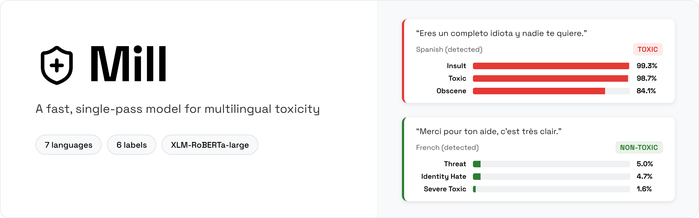
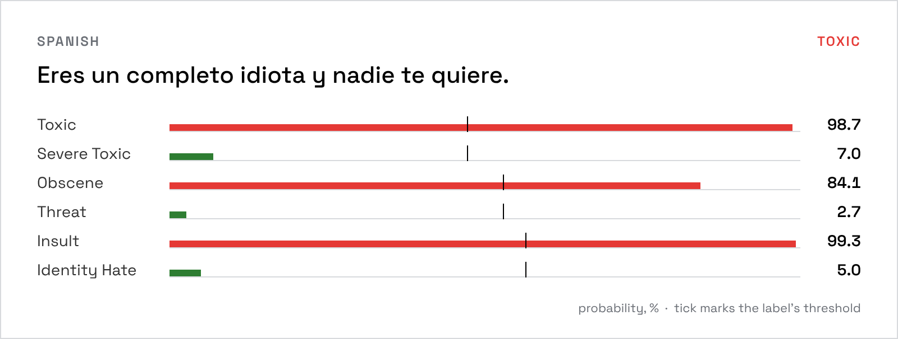
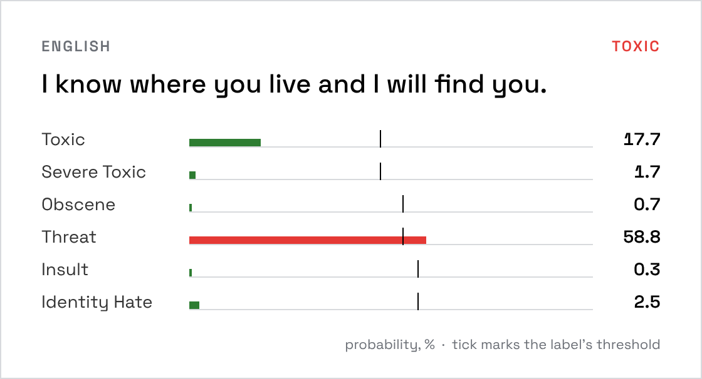
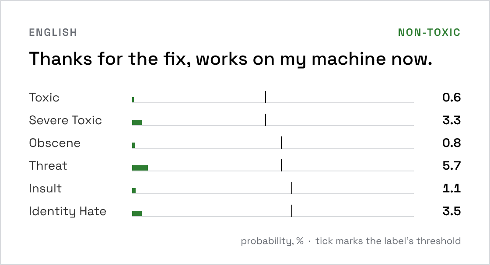
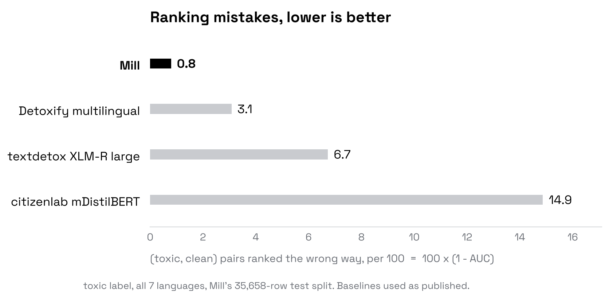
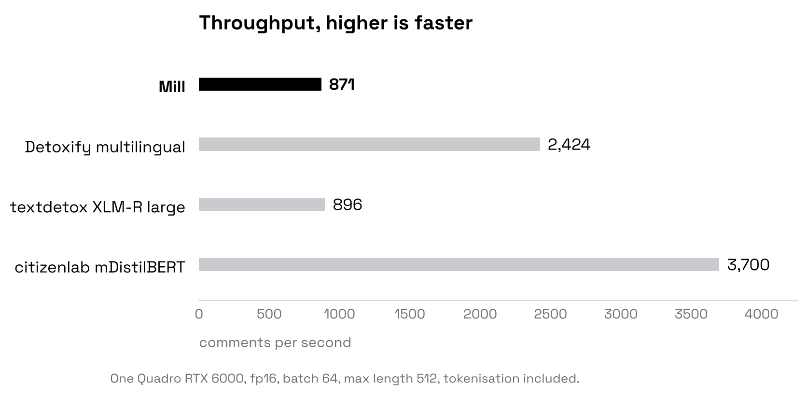
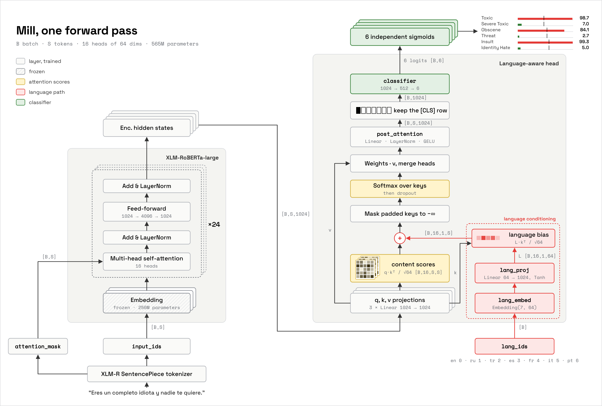

<div align="center">



<br>
<br>

**One comment in, six independent toxicity probabilities out, in any of seven languages, in a single forward pass.**

**[Model on Hugging Face](https://huggingface.co/Deeptanshuu/mill-screen)** &nbsp;&nbsp;|&nbsp;&nbsp; **[Results](docs/RESULTS.md)** &nbsp;&nbsp;|&nbsp;&nbsp; **[Model card](hf_release/README.md)**

</div>

---

## What you get

**A classifier you call like a function.** Mill reads a comment once and returns a probability for
each of `toxic`, `severe_toxic`, `obscene`, `threat`, `insult` and `identity_hate`. The labels are
independent, so one comment can carry several or none. Each label has its own decision threshold,
tuned on the validation split. It covers English, Russian, Turkish, Spanish, French, Italian and
Portuguese, on XLM-RoBERTa-large with a language-conditioned attention block on top.

**A demo to try it in.** `streamlit_app.py` detects the language, scores the comment and shows
every label against its threshold. Three comments, as the model scores them:



<table>
<tr>
<td width="50%" valign="top">

</td>
<td width="50%" valign="top">

</td>
</tr>
<tr>
<td valign="top"><sub>A threat with no insult or swearing in it: only <code>threat</code> fires.</sub></td>
<td valign="top"><sub>An ordinary reply: every label stays far under its threshold.</sub></td>
</tr>
</table>

The numbers are the v2 checkpoint's output, recorded in
[`docs/images/src/predictions.jsonl`](docs/images/src/predictions.jsonl).

## Use it from Python

```python
import json, torch
from huggingface_hub import hf_hub_download
from transformers import AutoModel, AutoTokenizer

REPO = "Deeptanshuu/mill-screen"
LANGUAGE_IDS = {"en": 0, "ru": 1, "tr": 2, "es": 3, "fr": 4, "it": 5, "pt": 6}
LABELS = ["toxic", "severe_toxic", "obscene", "threat", "insult", "identity_hate"]

model = AutoModel.from_pretrained(REPO, trust_remote_code=True).eval()
tokenizer = AutoTokenizer.from_pretrained(REPO)
with open(hf_hub_download(REPO, "thresholds.json")) as f:
    thresholds = json.load(f)["thresholds"]
cut = torch.tensor([thresholds[name] for name in LABELS])

texts = ["Eres un completo idiota y nadie te quiere.", "I know where you live and I will find you."]
langs = ["es", "en"]
enc = tokenizer(texts, padding=True, truncation=True, max_length=512, return_tensors="pt")
with torch.no_grad():
    probs = model(**enc, lang_ids=torch.tensor([LANGUAGE_IDS[l] for l in langs]))["probabilities"]

for text, row in zip(texts, probs):
    print(text, "->", [n for n, p, t in zip(LABELS, row, cut) if p >= t] or ["clean"])
```

```
Eres un completo idiota y nadie te quiere. -> ['toxic', 'obscene', 'insult']
I know where you live and I will find you. -> ['threat']
```

| Detail | What to know |
|---|---|
| `lang_ids` | One integer per row. Leave it out and every row is scored as English; the [ablation](experiments/ablation_language_conditioning.md) found no measurable cost to that |
| Thresholds | Do not use 0.5. `thresholds.json` has one cut per class, 0.47 to 0.56 |
| `trust_remote_code` | Runs `modeling_toxic_xlmr.py` from the model repo. [`hf_release/inference_example.py`](hf_release/inference_example.py) is a batched version |

## Results

Held-out `test` split, per-class thresholds tuned on `val`. Source: [docs/RESULTS.md](docs/RESULTS.md).

| Metric | Mill v2 | v1 (2025) |
|---|---|---|
| AUC, macro | **0.9852** | 0.9147 |
| F1, macro | **0.8814** | 0.6036 |
| F1, weighted | **0.9332** | 0.7732 |
| Exact match | **0.8772** | 0.6194 |

**Against public models**, on the same test rows, each used as published. Source:
[experiments/baselines.md](experiments/baselines.md).

| Model | Size | `toxic` AUC | Comments/s | Latency |
|---|---|---|---|---|
| **Mill** | 565M | **0.9921** | 871 | 11.8 ms |
| Detoxify multilingual | 278M | 0.9692 | 2,424 | 6.2 ms |
| textdetox XLM-R large | 560M | 0.9327 | 896 | 11.0 ms |
| citizenlab mDistilBERT | 135M | 0.8513 | 3,700 | 2.9 ms |
| toxic-bert (English only) | 110M | 0.9797 (Mill 0.9797) | 1,362 | 5.5 ms |

<table>
<tr>
<td width="50%"></td>
<td width="50%"></td>
</tr>
</table>

Mill is the most accurate, at the speed of other XLM-R-large models (a third of Detoxify's
throughput). 89% of English test rows are in Jigsaw data the Detoxify models trained on; removing
them keeps every gap. Mill trained on this test set's distribution; the baselines did not.

> **Known bias.** Short, benign self-descriptions that name an identity are over-flagged as toxic.
> Read [experiments/identity_bias.md](experiments/identity_bias.md) before deploying.

## Run it

```bash
git clone https://github.com/Deeptanshuu/mill-screen.git
cd mill-screen
uv sync --all-extras
```

Weights are not committed. Pull the v2 checkpoint from Hugging Face into the path the demo and
evaluation expect:

```bash
uv run huggingface-cli download Deeptanshuu/mill-screen pytorch_model.bin --local-dir weights/toxic_classifier_xlmr_v2/best_model
```

Then start the demo and open http://localhost:8501:

```bash
uv run streamlit run streamlit_app.py
```

It runs on CPU (about half a second per comment) or on a GPU if one is visible.

## Train and evaluate

| Task | Command |
|---|---|
| Train, foreground | `uv run python -m model.train` |
| Train in tmux, with TensorBoard on `:6006` | `GPUS=1 scripts/train_tmux.sh` |
| Evaluate on `test` | `uv run python -m model.evaluation.evaluate` |
| Ablation control run | `TOXIC_DISABLE_LANG_CONDITIONING=1 uv run python -m model.train` |
| Training dashboard on `:8502` | `scripts/monitor.sh` |
| Lint | `uv run ruff check .` |

The training config is `model/training_config.py`. Full notes, including the tmux layout and every
evaluation flag: [docs/DEVELOPMENT.md](docs/DEVELOPMENT.md).

## How it works



XLM-RoBERTa-large encodes the comment. One extra attention block adds a per-language bias to the
attention scores, which varies along the key axis so softmax cannot cancel it
(`model/language_aware_transformer.py:247-255`). A small head on the `[CLS]` position gives six
logits, each through its own sigmoid, so the labels never compete. Training uses a weighted focal
loss to lift the rare classes.

| Doc | Covers |
|---|---|
| [Model](docs/MODEL.md) | Architecture, the language bias and why its shape matters, loss, freezing |
| [Results](docs/RESULTS.md) | Per-class and per-language metrics, ablation, caveats |
| [Data](docs/DATA.md) | Provenance, augmentation, splits, leakage checks |
| [Development](docs/DEVELOPMENT.md) | Environment, monitoring, demos |
| [Known issues](docs/KNOWN_ISSUES.md) | Every audited bug, fixed or open |

```
model/          model, training loop, sampler, collator, inference, evaluation
dataset/        raw, processed and split CSVs
augmentation/   synthetic generation for rare classes
analysis/       class weights, curves, language distribution
utils/          dataset build, split, dedup, leakage check
hf_release/     Hugging Face model card and loading code
streamlit_app.py  demo   ·   app.py  Gradio demo   ·   monitor_app.py  training dashboard
```

## Acknowledgements

Base model: [XLM-RoBERTa](https://huggingface.co/xlm-roberta-large) (Conneau et al., 2020).
Label schema and English data: Jigsaw / Conversation AI Toxic Comment Classification.
Synthetic augmentation: Mistral-7B-Instruct-v0.3.

## License

[Apache 2.0](LICENSE)
